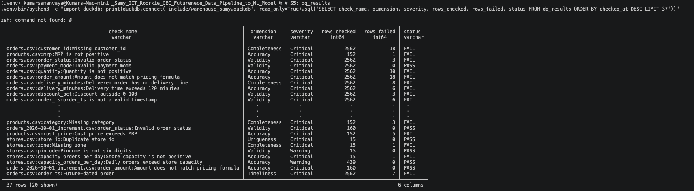
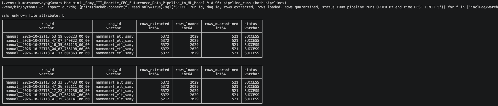
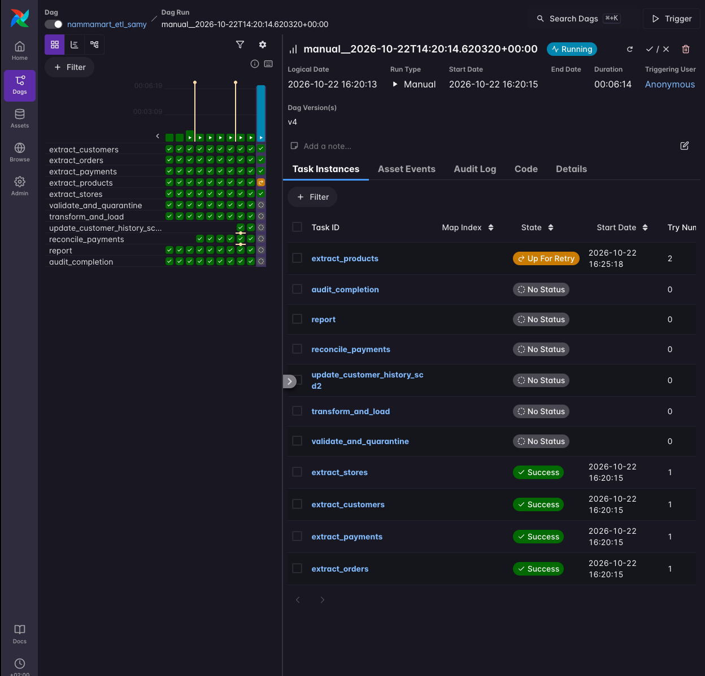
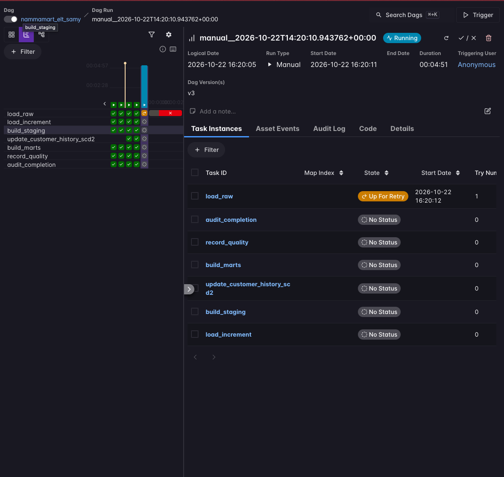
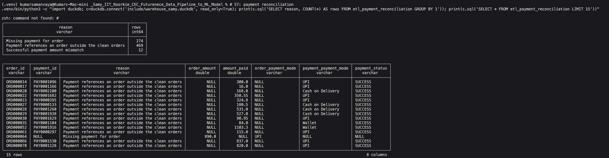
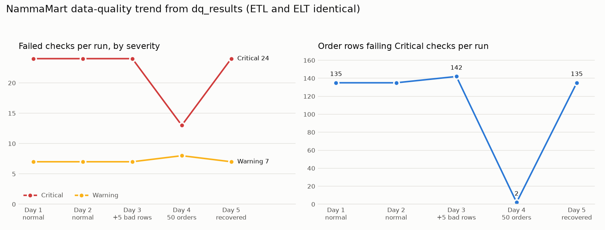
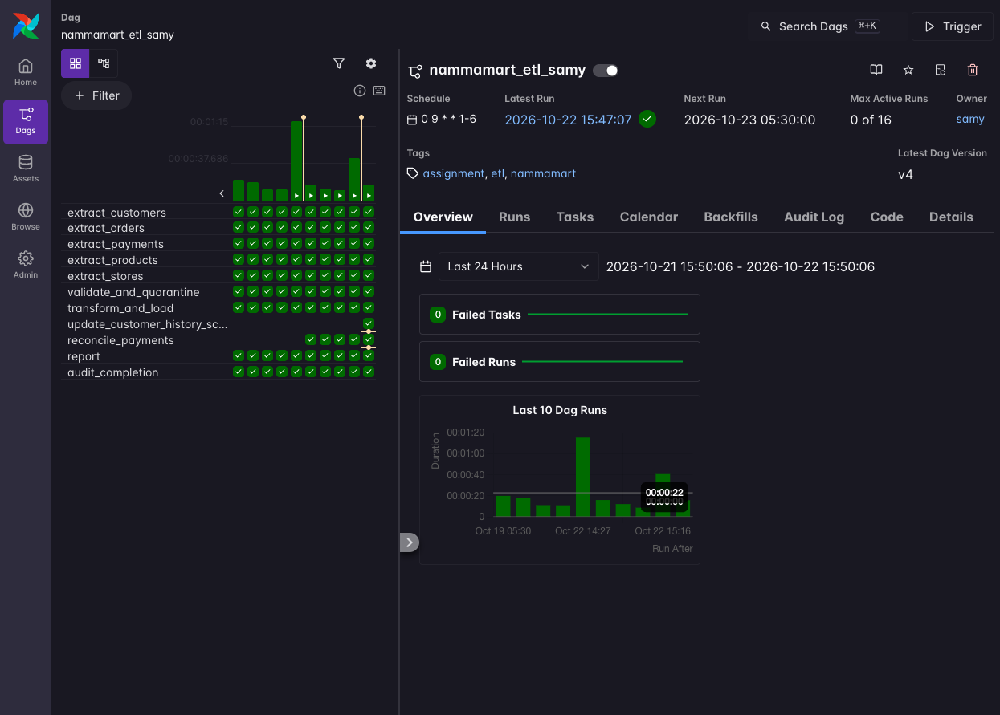
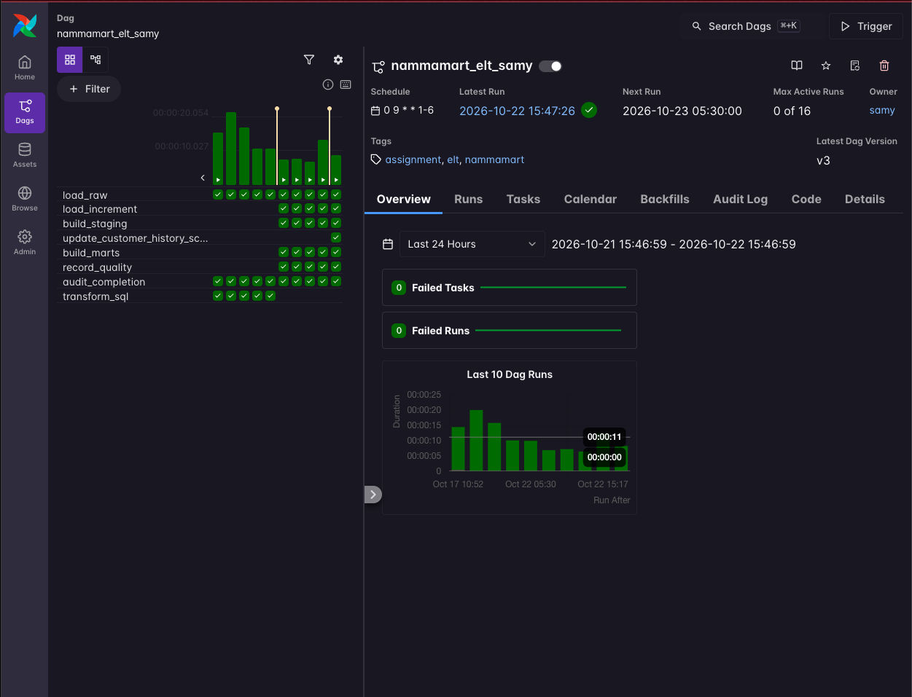
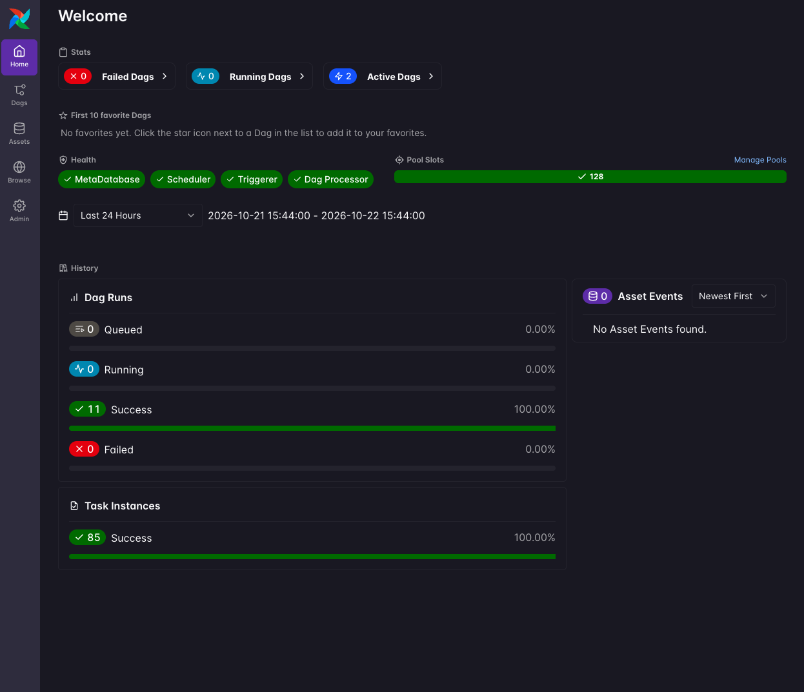

# NammaMart ETL & ELT Pipelines: Submission

Learner: Kumar Samanvaya (`samy`) · Module: FDAIE Module 2, Data Engineering Foundations · Runtime: Astro Runtime 3.3 (Apache Airflow 3), DuckDB, pandas

This file is the assignment submission. It follows the checklist in [assignment/ASSIGNMENT.md](assignment/ASSIGNMENT.md) §6. Every number below comes from executed notebooks in [Documentation/](Documentation/) or from Airflow runs of the two DAGs. Working notes from earlier iterations are kept separately in [Documentation/SUBMISSION.md](Documentation/SUBMISSION.md).

Github link : https://github.com/samanvaya/_Samy_IIT_Roorkie_CEC_Futurenece_Data_Pipeline_to_ML_Model/blob/main/Documentation/SUBMISSION.md

> Screenshots: Airflow UI and query evidence is in `Documentation/screenshots/` and embedded where relevant; the index is in [§13](#13-screenshots).

---

## Contents

1. [Acceptance criteria at a glance](#1-acceptance-criteria-at-a-glance)
2. [Repository map and how to run](#2-repository-map-and-how-to-run)
3. [Part 0: Profiling and Data Issues Log](#3-part-0-profiling-and-data-issues-log)
4. [Part A: ETL pipeline](#4-part-a-etl-pipeline)
5. [Part B: ELT pipeline and ETL/ELT reconciliation](#5-part-b-elt-pipeline-and-etlelt-reconciliation)
6. [Part C: Scheduling answers](#6-part-c-scheduling-answers)
7. [Part D: Data quality dimensions](#7-part-d-data-quality-dimensions)
8. [Part E: Data governance](#8-part-e-data-governance)
9. [Part F: Observability tests](#9-part-f-observability-tests)
10. [Business questions (both pipelines)](#10-business-questions-both-pipelines)
11. [Part G: Recommendation to the CTO](#11-part-g-recommendation-to-the-cto)
12. [Bonus features](#12-bonus-features)
13. [Screenshots](#13-screenshots)
14. [Repository safety checklist](#14-repository-safety-checklist)

---

## 1. Acceptance criteria at a glance

| # | Client expectation | Evidence | Status |
|---|---|---|---|
| 1 | Ready before 9:00 AM IST, Monday to Saturday | `schedule="0 9 * * 1-6"`, `start_date` in `Asia/Kolkata` in both DAGs; [§6](#6-part-c-scheduling-answers); UI shows next run 05:30 UTC+2 = 09:00 IST ([§13](#13-screenshots)) | Done |
| 2 | No bad order reaches finance tables | `etl_fact_orders` holds only orders that passed every Critical rule (1,903 for September); [§4](#4-part-a-etl-pipeline) | Done |
| 3 | Every raw record kept, untouched | `raw_*` tables hold all 5,212 base rows (plus 160 increment rows) as text with `_loaded_at`, `_source_file`, `_run_id`; [§5](#5-part-b-elt-pipeline-and-etlelt-reconciliation) | Done |
| 4 | Bad rows set aside with a reason | `include/quarantine/samy/<file>_failed_<run_id>.csv` with `failure_reason`; ELT `stg_*.dq_status` + `failure_reason`; all 497 rejected September orders are recorded in both | Done |
| 5 | Re-running never double-counts | Rerun: ETL fact 1,903 → 1,903; ELT raw 2,412 → 2,412, staging 2,400 → 2,400 (Exp 2) | Done |
| 6 | Incremental load with late status changes | 150 inserted, 10 updated to RETURNED, 0 duplicate order IDs; ETL and ELT both 2,029 orders (Exp 3) | Done |
| 7 | Orders reconcile with payments | `etl_payment_reconciliation` / `mart_payment_reconciliation`: 629 identical mismatch rows (September) | Done |
| 8 | Customer personal data protected | Email/phone masked in every reporting table and quarantine file; raw customer PII isolated in an owner-only file; [§8.4](#84-personal-data-handling) | Done |
| 9 | Anyone can see whether today's run worked | Airflow run history and task logs, `pipeline_runs` written by a final `all_done` task (SUCCESS/FAILED), `dq_results` scorecard per run, Slack alert on failure | Done |
| 10 | Written recommendation | [§11](#11-part-g-recommendation-to-the-cto) | Done |

On the September data, ETL and ELT agree exactly:

| Metric | ETL | ELT |
|---|---:|---:|
| Clean orders | 1,903 | 1,903 |
| Delivered net revenue | ₹932,884.15 | ₹932,884.15 |
| Gross margin | ₹228,083.65 | ₹228,083.65 |
| Payment mismatch rows | 629 | 629 |
| Orders rejected | 497 | 497 |

After the October increment both pipelines show 2,029 orders, ₹993,654.00 revenue and 755 mismatch rows. All six business-question answers are identical between the pipelines ([§10](#10-business-questions-both-pipelines)).

---

## 2. Repository map and how to run

| Path | Purpose |
|---|---|
| [dags/nammamart_etl_samy.py](dags/nammamart_etl_samy.py) | ETL DAG: 5 parallel extracts → validate & quarantine → transform & load → customer history (SCD2) → reconcile → report → audit |
| [dags/nammamart_elt_samy.py](dags/nammamart_elt_samy.py) | ELT DAG: load raw → load increment → staging SQL → customer history (SCD2) → mart SQL → quality scorecard → audit |
| [include/data_quality.py](include/data_quality.py) | Shared Python quality rules (37 checks across the 6 dimensions; the volume check makes 38) and value standardisation |
| [include/masking.py](include/masking.py) | `mask_email`, `mask_phone` |
| [include/nammamart_etl.py](include/nammamart_etl.py) | ETL logic: extract, increment upsert, quarantine, star schema, reconciliation, reports |
| [include/nammamart_elt.py](include/nammamart_elt.py) | ELT logic: raw load, restricted PII file, SQL runner, increment append, scorecard |
| [include/observability.py](include/observability.py) | `pipeline_runs` audit, append-only `dq_results`, run-over-run volume check |
| [include/alerts.py](include/alerts.py) | Slack `on_failure_callback` and volume-warning alert (bonus) |
| [include/dq_trend.py](include/dq_trend.py) | Data-quality trend from `dq_results` (bonus) |
| [include/sql/](include/sql/) | `stg_*.sql`, `mart_*.sql`, `dq_checks_elt.sql`, `dim_customer_history.sql`, `business_questions_{etl,elt}.sql` |
| [include/data/nammamart/](include/data/nammamart/) | The six source CSVs (unchanged) |
| [include/quarantine/samy/](include/quarantine/samy/) | ETL quarantine files (email/phone masked) |
| `include/warehouse_samy.duckdb` | ETL warehouse (Airflow runs) |
| `include/warehouse_samy_elt.duckdb` | ELT warehouse (Airflow runs); raw customer PII is in `warehouse_samy_elt_pii.duckdb` (owner-only, git-ignored) |
| [Documentation/](Documentation/) | Executed test notebooks for every step, the CTO recommendation, and reference notes |
| [assignment/](assignment/) | Issues log, profile summary, step snapshots, Step 10 report, Step 11 query exports |

#### Run it

```text
astro dev start
astro dev run dags list-import-errors        # → "No data found" (no import errors)
astro dev run dags test nammamart_etl_samy   # → state=success
astro dev run dags test nammamart_elt_samy   # → state=success
```

The notebooks in `Documentation/` are run from the repository root, except Step 13, which is run from `Documentation/`. They use the same `include/` modules as the DAGs and write their warehouses under `assignment/`.

---

## 3. Part 0: Profiling and Data Issues Log

Notebook: [Documentation/profiling_nammamart.ipynb](Documentation/profiling_nammamart.ipynb) · Outputs: [assignment/data_issues_log.csv](assignment/data_issues_log.csv) (row-level, 530 rows), [assignment/data_profile_summary.csv](assignment/data_profile_summary.csv). The pipeline rules in [Documentation/step4_quality_helpers_test.ipynb](Documentation/step4_quality_helpers_test.ipynb) extend this with the checks marked †.

### 3.1 Profile highlights

| File | Rows | Key findings |
|---|---:|---|
| `orders.csv` | 2,412 | 18 null `customer_id`; 164 null `delivery_minutes` (most are CANCELLED/RETURNED, 8 are DELIVERED); 24 rows share 12 duplicate `order_id`s; `quantity` −3…5; `discount_pct` 0…250; `order_amount` −1,593…9,576; `delivery_minutes` 8…1,440; `order_ts` up to 2027-01-01; store IDs S00, S17, S99 not in the store master; `payment_mode` has 8 spellings; `order_status` includes `Pending??` and `delivered` |
| `payments.csv` | 2,228 | 301 null `gateway_ref`; 8 duplicate `payment_id` rows; `amount_paid` −1,593…9,576; `payment_ts` up to 2027-01-01 |
| `customers.csv` | 405 | 10 rows share 5 duplicate `customer_id`s (with different phone/area); 4 null email; 6 null city; pincodes `5600XX`, `000000`; `loyalty_tier` in 7 casings |
| `products.csv` | 152 | 2 duplicate `product_id`s (each with an `(old)` row at a lower MRP); 3 missing category; MRP ≤ 0; cost price > MRP |
| `stores.csv` | 15 | S07 has no zone; S12 has capacity ≤ 0 |
| `orders_2026-10-01_increment.csv` | 160 | Clean on all rules; 150 new orders and 10 corrections (DELIVERED → RETURNED) |

Referential integrity: 18 orders reference an unknown customer (all of them the blank IDs), 9 an unknown product and 5 an unknown store (S00, S17, S99). 8 payments reference an unknown order. Cancelled orders correctly have no payment.

### 3.2 Data Issues Log (summary; full row-level log in the CSV)

| File | Example row key | Column | Problem | Rows | Dimension | Proposed rule | Severity |
|---|---|---|---|---:|---|---|---|
| orders.csv | ORD002255 | customer_id | Missing customer_id | 18 | Completeness | customer_id must be present | Critical |
| orders.csv | ORD001462 | order_id | Duplicate order_id | 24 | Uniqueness | order_id must be unique | Critical |
| orders.csv | ORD001812 | payment_mode | Non-standard spelling (`upi`, `UPI `, `CARD`, `cod`, `Cashh`) | 10 | Validity | Standardise to UPI / Card / Cash on Delivery / Wallet | Warning (fixed by standardising) |
| orders.csv | ORD000500 | order_status | Invalid status `Pending??` (and `delivered` casing, standardised) | 3 | Validity | DELIVERED, CANCELLED or RETURNED | Critical |
| orders.csv | ORD000469 | quantity | Quantity ≤ 0 | 10 | Accuracy | quantity > 0 | Critical |
| orders.csv | ORD002103 | order_amount | Amount ≠ qty × price × (1 − discount) | 18 | Accuracy | Match formula within ₹0.01 | Critical |
| orders.csv | ORD001554 | delivery_minutes | DELIVERED order without delivery time | 8 | Completeness | DELIVERED requires delivery_minutes | Critical |
| orders.csv | ORD001037 | delivery_minutes | Delivery time > 120 min (max 1,440) | 6 | Accuracy | delivery_minutes ≤ 120 | Critical |
| orders.csv | ORD001468 | discount_pct | Discount outside 0 to 100 (max 250) † | 3 | Validity | 0 ≤ discount_pct ≤ 100 | Critical |
| orders.csv | ORD001610 | order_ts | Not a timestamp (`2026-13-05`, `31/09/2026`, blank) † | 6 | Validity | order_ts parses as a timestamp | Critical |
| orders.csv | ORD002119 | order_ts | Dated after the 1 Oct export (2027-01-01; ORD001693 = 2026-10-21) | 7 | Timeliness | order_ts ≤ end of latest export day | Critical |
| orders.csv | ORD000986 | product_id | Unknown product_id | 9 | Consistency | Must exist in products | Critical |
| orders.csv | ORD001799 | store_id | Unknown store_id (S00/S17/S99) | 5 | Consistency | Must exist in stores | Critical |
| orders.csv | (dataset) | order_ts | Latest order older than 1 day at run time † | 1 check | Timeliness | Newest order ≤ 1 day old | Warning |
| payments.csv | PAY0001651 | payment_id | Duplicate payment_id | 8 | Uniqueness | payment_id must be unique | Critical |
| payments.csv | PAY0000133 | gateway_ref | Missing gateway reference | 301 | Completeness | gateway_ref required for audit | Warning |
| payments.csv | PAY0001568 | amount_paid | Amount ≤ 0 | 10 | Accuracy | amount_paid > 0 | Critical |
| payments.csv | PAY0002219 | order_id | Unknown order_id | 8 | Consistency | Must exist in orders | Critical |
| payments.csv | PAY0001568 | amount_paid | SUCCESS amount ≠ order amount | 14 | Consistency | SUCCESS payment = order_amount | Critical |
| customers.csv | C00103 | customer_id | Duplicate customer_id (different phone/area) | 10 | Uniqueness | One row per customer (keep first) | Critical |
| customers.csv | C00337 | email | Invalid or missing email | 12 | Validity | Valid email format | Warning |
| customers.csv | C00151 | phone | Not 10 digits | 7 | Validity | Exactly 10 digits | Warning |
| customers.csv | C00132 | pincode | Not 6 digits (`5600XX`, `000000`) | 3 | Validity | Exactly 6 digits | Warning |
| customers.csv | C00355 | city | Missing city | 6 | Completeness | city should be present | Warning |
| customers.csv | C00199 | loyalty_tier | Mixed casing (`BRONZE`, `bronze`, `SILVER`) † | 8 | Consistency | One casing: Bronze/Silver/Gold/Platinum | Warning |
| customers.csv | C00400 | signup_date | Signup after the export date † | 3 | Timeliness | signup_date ≤ export date | Warning |
| products.csv | P0030 | product_id | Duplicate product_id (`(old)` row) | 4 | Uniqueness | One row per product (keep first) | Critical |
| products.csv | P0051 | category | Missing category | 3 | Completeness | category required | Critical |
| products.csv | P0109 | mrp | MRP ≤ 0 | 1 | Accuracy | mrp > 0 | Critical |
| products.csv | P0019 | cost_price | Cost price > MRP | 5 | Accuracy | cost_price ≤ mrp | Critical |
| stores.csv | S07 | zone | Missing zone | 1 | Completeness | zone required | Critical |
| stores.csv | S12 | capacity_orders_per_day | Capacity ≤ 0 | 1 | Accuracy | capacity > 0 | Critical |

Issues were found in all five base files. The increment file passed every rule.

### 3.3 Questions for the client before building

1. When an order is returned after the month closes, should September revenue be restated, or should finance keep the originally reported figure and book the return in October?
2. Should Warning-level customer issues (bad email/phone format) be loaded masked, or held back until CRM fixes them?
3. When an order has more than one payment, or a payment for a cancelled order, which payment is authoritative for reconciliation?
4. Should an order be rejected when only its store or product record is faulty (e.g. store S07 has no zone)? The pipelines currently reject these 311 orders; my recommendation is to load them under an "Unknown" zone or category instead (see [§5.3](#53-business-rule-to-confirm)).

---

## 4. Part A: ETL pipeline

DAG: `nammamart_etl_samy` · Notebooks: [step5_etl_test](Documentation/step5_etl_test.ipynb), [step7_incremental_test](Documentation/step7_incremental_test.ipynb)

| Step | Implementation |
|---|---|
| Extract | Five parallel tasks `extract_orders`, `extract_payments`, `extract_customers`, `extract_products`, `extract_stores`. Each reads only its own file, so a missing file fails exactly one task. |
| Validate | `validate_and_quarantine` runs the 37 shared rules ([§7](#7-part-d-data-quality-dimensions)) after standardising values. Orders whose customer, product or store failed a Critical rule are also rejected, with a reason. |
| Quarantine | `include/quarantine/samy/<file>_failed_<run_id>.csv` with one combined `failure_reason` per row; email/phone masked |
| Transform | Trim and fix casing (`upi`/`UPI ` → `UPI`, `cod`/`Cashh` → `Cash on Delivery`, `delivered` → `DELIVERED`, loyalty tier → `Bronze`…); deduplicate customers and products (keep first row); mask email/phone (`pr***@example.com`, `97******21`); inner-join to dimensions; derive `order_date`, `net_revenue`, `gross_margin`, `within_15_min` |
| Load (star schema) | `etl_fact_orders`, `etl_dim_customer`, `etl_dim_product`, `etl_dim_store`; each run replaces the tables (`CREATE OR REPLACE`), so loads are idempotent |
| Reconcile | `reconcile_payments` writes `etl_payment_reconciliation`, one row per mismatch with `reason` |
| Report | `report` builds `etl_daily_zone_revenue` and `etl_category_margin` and prints both in the task log |
| Customer history | `update_customer_history_scd2` maintains `etl_dim_customer_history`, the SCD Type 2 loyalty-tier history ([§12.4](#124-scd-type-2-loyalty-tier-history)) |
| Audit | `audit_completion` (`trigger_rule="all_done"`) writes `pipeline_runs` with SUCCESS or FAILED |
| Alerting | Every task has `on_failure_callback=notify_failure`, which sends a Slack alert after the final retry ([§12.1](#121-slack-alert-on-failure)) |

September run (notebook): 5,212 rows extracted → 1,903 fact rows, 497 orders rejected, 629 reconciliation rows. Dimensions: 400 customers, 142 products, 13 stores.
Airflow run (includes the increment): 5,372 rows extracted → 2,029 fact rows, 521 orders rejected, 755 reconciliation rows (274 orders without a payment, because `payments.csv` does not yet cover the 150 October orders).

---

## 5. Part B: ELT pipeline and ETL/ELT reconciliation

DAG: `nammamart_elt_samy` · Notebooks: [step6_elt_test](Documentation/step6_elt_test.ipynb), [step7_incremental_test](Documentation/step7_incremental_test.ipynb)

| Layer | Tables | Implementation |
|---|---|---|
| Raw | `raw_orders`, `raw_payments`, `raw_products`, `raw_stores` (warehouse) and `raw_customers` (restricted `_pii` file) | Every row as text, no pandas cleaning, plus `_loaded_at`, `_source_file`, `_run_id` |
| Staging | `stg_orders`, `stg_payments`, `stg_customers`, `stg_products`, `stg_stores` | SQL only ([include/sql/stg_*.sql](include/sql/)): cast, standardise, dedupe, mask PII, quality rules, `dq_status` + `failure_reason` |
| Mart | `mart_daily_store_kpis`, `mart_category_margin`, `mart_delivery_sla`, `mart_payment_reconciliation`, `mart_top_customers` | SQL only ([include/sql/mart_*.sql](include/sql/)) |
| Scorecard | `dq_results` | SQL ([include/sql/dq_checks_elt.sql](include/sql/dq_checks_elt.sql)), same 38 check names as ETL |

Airflow runs one task per layer: `load_raw` → `load_increment` → `build_staging` → `update_customer_history_scd2` → `build_marts` → `record_quality` → `audit_completion`.

### 5.1 Incremental load (MERGE / upsert)

- Raw: `load_increment` appends the 160 increment rows to `raw_orders` (2,412 → 2,572). Nothing is overwritten.
- Staging: `stg_orders.sql` keeps the latest `_loaded_at` row per `order_id`, which is the SQL equivalent of a MERGE on `order_id`. Result: 150 inserted, 10 updated, 2,550 unique staged orders, 0 duplicate IDs. The 10 corrected orders (e.g. ORD000017, ORD000271) now show `RETURNED` with `_source_file = orders_2026-10-01_increment.csv`, while raw still holds the original DELIVERED rows.
- Duplicates inside one file are still failed as "Duplicate order_id", because they are counted per load before the merge.

### 5.2 Mart totals match ETL totals

| September | ETL | ELT |
|---|---:|---:|
| Net revenue | ₹932,884.15 | ₹932,884.15 |
| Difference | | ₹0.00 |

Verified in [Documentation/step11_business_questions_test.ipynb](Documentation/step11_business_questions_test.ipynb), cell 3 ("September totals match within one cent"), and in `assignment/step11_business_questions/september_total_comparison.json`. The order IDs in `etl_fact_orders` and the passing rows of `stg_orders` are the same set: 0 IDs in only one pipeline.

The first versions of the two pipelines differed by 467 orders (ETL 1,851 vs ELT 2,318). The cause was rule drift between the Python and SQL implementations:

- ETL rejected orders linked to failed dimensions; ELT only checked that the key existed.
- ELT's duplicate check could never fire because it deduplicated first.
- ETL quarantined `upi` instead of standardising it.
- The 120-minute rule existed only in ETL.
- An unparseable `order_ts` was treated differently.

Each rule now behaves the same in both pipelines. The full analysis is in [Documentation/SUBMISSION.md](Documentation/SUBMISSION.md) ("ETL / ELT reconciliation fix").

### 5.3 Business rule to confirm

Both pipelines reject orders whose product or store fails its own Critical checks. Store S07 (no zone) and S12 (zero capacity) alone account for 311 orders. This is the strict, finance-safe interpretation, and it is what the submitted pipelines do.

Recommendation (pending Finance and Operations sign-off): load these orders and flag the store or product record instead. Industry practice (Kimball's "unknown member" pattern) is to reject a row only when the defect is in the row itself, or when it makes the published number wrong. The 311 orders are real sales that the payment gateway shows as collected. Dropping them because a store record is missing its zone understates revenue and recreates the "doesn't reconcile" problem the client hired us to fix.

| Defect | Affects revenue? | Recommended handling of the order | Severity for the order |
|---|---|---|---|
| Store S07 has no zone | No, only zone reporting | Load; report under an "Unknown" zone; raise a ticket with the store-master owner | Warning |
| Store S12 capacity ≤ 0 | No | Load; the capacity field is unreliable | Warning (store row stays flagged) |
| Product missing category | No, only category reporting | Load under "Uncategorised" | Warning |
| Product MRP ≤ 0 or cost > MRP | Revenue no; margin yes | Load the revenue; leave gross margin blank until the catalogue is fixed | Warning (excluded from margin) |
| Store or product ID not in the master (S00, S17, S99) | Possibly: may be a test or fake order | Keep rejecting, or hold as late-arriving until the master catches up | Critical (unchanged) |
| Defect in the order itself (amount, duplicate, date, status) | Yes | Reject | Critical (unchanged) |

The "Critical" label stays on the faulty store or product row; it does not make the customer's order invalid. Loading the orders also makes the problem visible: an "Unknown zone: ₹X" line tells the COO there is a store-master record to fix, while a smaller total tells nobody anything. Once the owner corrects the record, the next run puts every past order in the right zone or category without a replay. Finance's guarantee still holds, because no invalid order reaches the fact table; only descriptive labels are marked unknown.

Implementation is small: an unknown-member default in `stg_orders.sql` and the mart joins (ELT), and the same fallback in the ETL dimension join. The change must be made in both pipelines together so they stay reconciled ([§5.2](#52-mart-totals-match-etl-totals)).

---

## 6. Part C: Scheduling answers

Notebook: [Documentation/step8_schedule_test.ipynb](Documentation/step8_schedule_test.ipynb) (all checks pass)

```python
@dag(
    schedule="0 9 * * 1-6",
    start_date=pendulum.datetime(2026, 9, 1, tz="Asia/Kolkata"),
    catchup=False,
    default_args={"retries": 2, "retry_delay": timedelta(minutes=5),
                  "execution_timeout": timedelta(minutes=30)},
)
```

| Question | Answer |
|---|---|
| What is your cron expression? | `0 9 * * 1-6`: minute 0, hour 9, every day of the month, every month, Monday (1) to Saturday (6). |
| What time does the run show in UTC in the Airflow UI? | 03:30 UTC, because IST is UTC+5:30. The UI displays times in the browser's timezone: on my machine (UTC+2) the DAG page shows Next Run 2026-10-23 05:30:00, which is 03:30 UTC = 09:00 IST ([§13](#13-screenshots)). With the UI timezone set to UTC it shows 03:30; with Asia/Kolkata, 09:00. |
| What if `start_date` had been left in UTC? | The cron would be read in UTC, so "9 AM" would run at 14:30 IST, five hours after the 9:30 AM stand-up. The data would always arrive too late. |
| What if the laptop or Docker is off at 9 AM? | No scheduler is running, so no run is created and the report is not ready. When Airflow starts again, `catchup=False` stops it from creating a backlog of every missed day. At most the latest missed slot is scheduled; otherwise the next run is the next 09:00. The operator should trigger the DAG manually. Production needs an always-on deployment (e.g. Astro Cloud or a server). |
| Why `catchup=False`? | Each run reloads the full source files and replaces the derived tables, so replaying old intervals would recompute the same state. A backfill only adds load and noise. Missed days are recovered by one manual run. |
| Retries, retry delay and timeout | `retries=2`, `retry_delay=5 min` (absorbs a late file drop or a locked file) and `execution_timeout=30 min` (a hung task fails long before the 9:30 meeting instead of blocking silently). Worst case: 3 attempts × ≤30 min. A failing run is visible by about 9:10 for typical sub-minute tasks. |

---

## 7. Part D: Data quality dimensions

The same rules run in both pipelines. Python ([include/data_quality.py](include/data_quality.py)) serves ETL; SQL ([include/sql/stg_orders.sql](include/sql/stg_orders.sql) for row-level `dq_status`, and [include/sql/dq_checks_elt.sql](include/sql/dq_checks_elt.sql) for the scorecard) serves ELT. Critical rows are quarantined in ETL and marked `FAIL` in ELT staging. Warning rows load but are logged.

| Dimension | Checks (both pipelines) | Severity |
|---|---|---|
| Completeness | customer_id present in orders; DELIVERED orders have delivery_minutes; category present in products; zone present in stores; gateway_ref present in payments | Critical / Warning (gateway_ref) |
| Uniqueness | order_id, payment_id, customer_id, product_id, store_id unique | Critical |
| Validity | order_status and payment_mode in allowed lists (after standardising); order_ts parses; discount_pct 0 to 100; email format; phone 10 digits; pincode 6 digits | Critical (status, mode, timestamp, discount) / Warning (email, phone, pincode) |
| Accuracy | quantity > 0; order_amount matches formula; delivery_minutes ≤ 120; mrp > 0; cost_price ≤ mrp; amount_paid > 0; store capacity > 0 | Critical |
| Accuracy (bonus) | Orders per store per day ≤ `capacity_orders_per_day` | Warning |
| Consistency | customer/product/store IDs exist in masters; payment order exists; SUCCESS payment = order amount; loyalty_tier uses one casing | Critical (keys, amounts) / Warning (casing) |
| Timeliness | No order_ts after the latest export day; no future signup_date; latest order ≤ 1 day old at run time | Critical (future order) / Warning (stale, signup) |
| Volume (Part F) | Order count did not drop > 90% vs the previous run (baseline read from `dq_results` history) | Warning |

`dq_results` has the required columns (`run_id`, `dag_id`, `check_name`, `dimension`, `severity`, `rows_checked`, `rows_failed`, `status`, `checked_at`). It is appended on every run (a retry of the same run replaces only that run's rows), so it builds a scorecard over time. On the September data, ETL and ELT record the same 38 checks with identical counts; 31 FAIL. Example rows:

| check_name | dimension | severity | rows_checked | rows_failed | status |
|---|---|---|---:|---:|---|
| orders.csv:order_id:Duplicate order_id | Uniqueness | Critical | 2,412 | 24 | FAIL |
| orders.csv:order_amount:Amount does not match pricing formula | Accuracy | Critical | 2,412 | 18 | FAIL |
| orders.csv:payment_mode:Invalid payment mode | Validity | Critical | 2,412 | 0 | PASS |
| orders.csv:order_ts:Future-dated order | Timeliness | Critical | 2,412 | 7 | FAIL |
| payments.csv:gateway_ref:Missing gateway reference | Completeness | Warning | 2,228 | 301 | FAIL |
| customers.csv:loyalty_tier:Loyalty tier casing is not standard | Consistency | Warning | 405 | 8 | FAIL |
| stores.csv:store_id:Duplicate store_id | Uniqueness | Critical | 15 | 0 | PASS |

Latest Airflow ETL run (2,562 current order rows after the increment upsert):



> Note on "future-dated". The latest export is dated 1 October 2026, so the rule rejects any order after the end of that day (`DATA_AS_OF = 2026-10-02`). Comparing with "now" would let ORD001693 (dated 21 Oct 2026, inside the September file) pass once that date arrives, and the numbers would change depending on the day the pipeline runs. In production this cut-off is the Airflow run's `data_interval_end`.

---

## 8. Part E: Data governance

### 8.1 Dataset ownership

| Dataset | Business owner | Technical custodian |
|---|---|---|
| orders (OMS export) | Operations (COO, Kavya) | Data Engineering |
| payments (gateway) | Finance | Data Engineering |
| customers (CRM, personal data) | CRM / Customer Operations, with Compliance | Data Engineering |
| products (catalogue) | Merchandising | Data Engineering |
| stores (store master) | Operations | Data Engineering |
| warehouse tables (raw, staging, marts, quarantine, dq_results, pipeline_runs) | Data Engineering, publishing certified marts to Finance and Ops | Data Engineering |

A change to a quality rule, such as the 120-minute delivery limit, is proposed by Data Engineering. It is approved by the business owner of the affected metric (Operations for delivery KPIs, plus Finance because rejected orders leave revenue), then merged through code review. It must be applied to `data_quality.py` and the SQL together, because the two drifted once ([§5.2](#52-mart-totals-match-etl-totals)).

### 8.2 Data dictionary

Fact table `etl_fact_orders` (ELT equivalent: passing rows of `stg_orders`), one row per clean order:

| Column | Type | Meaning | Source | Allowed values / rule | PII |
|---|---|---|---|---|---|
| order_id | VARCHAR | Order key | orders.order_id | Unique, non-empty | No |
| order_ts | TIMESTAMP | Order time | orders.order_ts | Valid, ≤ end of export day | No |
| order_date | VARCHAR (date) | Reporting date | derived from order_ts | 2026-09-01 … 2026-10-01 | No |
| customer_id / product_id / store_id | VARCHAR | Foreign keys | orders | Must exist in a passing dimension row | customer_id: pseudonymous key |
| quantity | BIGINT | Units ordered | orders | > 0 | No |
| unit_price | DOUBLE | Price per unit (₹) | orders | > 0 | No |
| discount_pct | BIGINT | Discount % | orders | 0 to 100 | No |
| order_amount | DOUBLE | Billed amount (₹) | orders | = quantity × unit_price × (1 − discount/100), 2 dp | No |
| payment_mode | VARCHAR | Payment method | orders (standardised) | UPI, Card, Cash on Delivery, Wallet | No |
| order_status | VARCHAR | Order status | orders (standardised) | DELIVERED, CANCELLED, RETURNED | No |
| delivery_minutes | DOUBLE | Minutes to deliver | orders | Required if DELIVERED; ≤ 120 | No |
| net_revenue | DOUBLE | Revenue counted | derived | order_amount if DELIVERED else 0 | No |
| gross_margin | DOUBLE | Margin (₹) | derived | net_revenue − quantity × cost_price | No |
| within_15_min | BOOLEAN | 15-minute SLA met | derived | DELIVERED and delivery_minutes ≤ 15 | No |
| full_name | VARCHAR | Customer name (denormalised) | customers | Not masked; restricted | Yes |
| email_masked / phone_masked | VARCHAR | Masked contact | customers, via masking.py | `pr***@domain`, `97******21` | Derived from PII (masked) |
| loyalty_tier | VARCHAR | Loyalty tier | customers (standardised) | Bronze, Silver, Gold, Platinum | No |
| category, cost_price, mrp | VARCHAR / DOUBLE | Product attributes | products | category non-empty; 0 < cost ≤ mrp | No |
| zone, store_name | VARCHAR | Store attributes | stores | North, South, East, West | No |

Dimensions:

| Table | Key | Columns | Notes |
|---|---|---|---|
| `etl_dim_customer` | customer_id (400 rows) | full_name (PII), email_masked, phone_masked, city, area, pincode (PII, quasi-identifier), signup_date, loyalty_tier, is_active | No raw email/phone |
| `etl_dim_product` | product_id (142 rows) | product_name, category, sub_category, brand, mrp, cost_price, unit, is_perishable, launch_date | Duplicate `(old)` rows removed |
| `etl_dim_store` | store_id (13 rows) | store_name, zone, area, pincode, open_date, manager_name (employee personal data), capacity_orders_per_day | S07 and S12 excluded (failed checks) |
| `etl_dim_customer_history` | customer_id + version | loyalty_tier, valid_from, valid_to, is_current, run_id | SCD Type 2 tier history ([§12.4](#124-scd-type-2-loyalty-tier-history)); ELT equivalent `dim_customer_history` |

### 8.3 Data lineage

Traced number: `mart_daily_store_kpis` for 2026-09-01, zone East, store S08 → `daily_net_revenue = ₹2,984.70`, `delivered_orders = 4`.

| order_id | `orders.csv` line | order_ts | order_amount | Status | Counted? |
|---|---:|---|---:|---|---|
| ORD000008 | 1050 | 2026-09-01 07:41:42 | 2,060.00 | DELIVERED | Yes |
| ORD000079 | 1351 | 2026-09-01 22:49:14 | 811.20 | DELIVERED | Yes |
| ORD000051 | 229 | 2026-09-01 17:19:45 | 73.60 | DELIVERED | Yes |
| ORD000056 | 193 | 2026-09-01 17:51:37 | 39.90 | DELIVERED | Yes |
| ORD000054 | 1567 | 2026-09-01 17:43:29 | 492.00 | RETURNED | No (not revenue) |

2,060.00 + 811.20 + 73.60 + 39.90 = 2,984.70. S08 maps to zone East in `stores.csv`.

- ELT: `mart_daily_store_kpis` → `stg_orders` (`dq_status='PASS'`, `order_status='DELIVERED'`) → `raw_orders`, where each row carries `_source_file = 'orders.csv'`, `_loaded_at` and `_run_id`. The trace is one SQL query per layer, entirely inside the warehouse.
- ETL: `etl_daily_zone_revenue` → `etl_fact_orders` → the CSV file. The fact table holds the transformed row; the original values exist only in the source file (or in quarantine if rejected), and nothing in the warehouse records which file or run produced a row.

ELT is easier, because raw values and run metadata sit next to the transformed rows, and the same tables can be re-queried after a rule change.

### 8.4 Personal-data handling

Personal data in the dataset. In customers: `full_name`, `email`, `phone` (direct identifiers), plus `area` and `pincode` (location, quasi-identifiers when combined), `signup_date`, `city`; stores: `manager_name` (employee). `customer_id` is a pseudonymous key.

How it is protected:

- Masking: `mask_email` keeps 2 characters and the domain (`priya.hegde199@example.com` → `pr***@example.com`). `mask_phone` keeps the first and last 2 digits (`9774349021` → `97******21`). ETL applies these in Python; ELT applies the identical rule in `stg_customers.sql`. All 400 customers get identical masked values in both pipelines.
- Raw email/phone never reach a reporting table: they are excluded from `etl_fact_orders`, and the dimensions and `mart_top_customers` hold only masked columns. Quarantine files mask email/phone too.
- ELT raw isolation: `raw_customers` stays an exact copy, as the assignment requires, but lives in `warehouse_samy_elt_pii.duckdb` with owner-only permissions (`0600`), git-ignored. It is attached read-only only while staging SQL runs. The shared ELT warehouse contains no raw PII.
- Verified: every table and quarantine file was scanned for the 806 real email/phone values. They appear only in the restricted file.

Why mask rather than delete: analytics still needs a stable, joinable customer (top customers, loyalty tiers, repeat orders), and support staff can recognise a customer from `pr***@example.com` without seeing the full address. Deleting the columns would also break legitimate CRM processes that hold the raw data under access control.

Law: the Digital Personal Data Protection Act, 2023 (DPDP Act), with its 2025 Rules. It expects processing only for a stated, lawful purpose with notice and consent; data minimisation; reasonable security safeguards against breaches; breach notification to the Data Protection Board and to affected people; deletion once the purpose is served or consent is withdrawn; and honouring individuals' rights to access, correction and erasure.

### 8.5 Access control

| Layer | Who can read |
|---|---|
| Raw PII (`warehouse_samy_elt_pii.duckdb` / `raw_customers`) | Nobody by default. Read only by the pipeline service account; break-glass access for named Compliance/CRM staff, logged |
| Raw (other `raw_*`) | Data Engineering; Finance/Compliance auditors (read-only) |
| Staging (`stg_*`) | Data Engineering, data analysts (masked fields only) |
| Marts (`mart_*`, `etl_*` reporting tables) | Finance, Operations, store managers, approved analysts (read-only) |
| Quarantine files / `failure_reason` | Data Engineering and data stewards in Ops/Finance who fix source data |
| `dq_results`, `pipeline_runs` | Everyone in the data team, plus Ops/Finance leads (health dashboard) |

Who should see raw phone numbers? Only the CRM/customer-support function that actually calls customers, in the CRM itself, not in the warehouse. Locally this is enforced with file permissions, because DuckDB has no per-table grants. In production it maps onto a restricted schema with role-based grants.

### 8.6 Retention

| Data | Retention | After that |
|---|---|---|
| Raw orders/payments | 8 years (books of account under the Companies Act, s.128; GST requires 6) | Archive to cold storage, then delete |
| Raw customer PII | While the account is active + a short grace period (e.g. 3 years after last order), or until consent is withdrawn (DPDP) | Delete or irreversibly anonymise (drop name/email/phone, keep a pseudonymous ID) |
| Quarantine files | 90 days after the issue is resolved | Delete (the raw layer keeps the source row) |
| Masked marts and dimensions | As long as needed for reporting (e.g. 3 years rolling) | Aggregate or delete |
| `dq_results`, `pipeline_runs` | 2 years (trend analysis, audits) | Delete |

Deletion runs as a scheduled, logged job. Periods must be confirmed with Legal and Finance.

### 8.7 Secrets management

No credentials are in the DAGs or the repository. Values such as `SLACK_WEBHOOK_URL` and `AZURE_OPENAI_API_KEY` are set as Airflow Variables (Admin > Variables, or `astro dev run variables set`) and read at runtime with `Variable.get()`. Local settings files that could hold them (`airflow_settings.yaml`, `.env`) are listed in `.gitignore` (see [include/ai_explainer.py](include/ai_explainer.py), [include/slack_notifier.py](include/slack_notifier.py)). They must never be in a DAG file or on GitHub because:

- DAG files are readable by anyone with repository or Airflow access.
- Git history keeps a secret even after it is "deleted".
- Bots scan public GitHub for keys within minutes.
- A leaked webhook lets anyone post into the company Slack.

If a secret leaks, revoke and rotate it immediately. The Step 12 notebook scans the repository for secret-shaped values (result: none).

### 8.8 Auditability

Finance's request: "pick any order that was rejected, show it as received, the rule it broke, and prove it is not in the CFO's revenue." Example: ORD001693.

1. Exactly as received: `orders.csv` line 288:
   `ORD001693, 2026-10-21 10:15:00, C00392, S03, P0045, 3, 387.0, 15, 986.85, UPI, DELIVERED, App, 18`.
   In ELT this is the same row in `raw_orders` with `_source_file='orders.csv'`, `_loaded_at` and `_run_id`.
2. Rule broken: Timeliness, "Future-dated order": a September export cannot contain an order dated 21 October.
   - ETL: `include/quarantine/samy/orders_failed_<run_id>.csv` has the row with `failure_reason = "Future-dated order"`.
   - ELT: `SELECT dq_status, failure_reason FROM stg_orders WHERE order_id='ORD001693'` returns `FAIL | Future-dated order`.
3. Not in revenue:
   - `SELECT count(*) FROM etl_fact_orders WHERE order_id='ORD001693'` returns 0.
   - `SELECT count(*) FROM stg_orders WHERE order_id='ORD001693' AND dq_status='PASS'` returns 0.
   - Every revenue table is built only from those rows, so its ₹986.85 is not part of the ₹932,884.15 total.

ETL answers from the quarantine file plus the fact table; ELT answers entirely with SQL inside the warehouse.

### 8.9 Change history and returned orders

Example: ORD000271 was DELIVERED on 4 September (₹445.00). The 1 October increment changes it to RETURNED. Ten such corrections exist; seven of them were clean September revenue (₹3,579.70 in total).

| | September net revenue |
|---|---:|
| Before the increment (both pipelines) | ₹932,884.15 |
| After the increment, ETL (`etl_fact_orders`, upserted) | ₹929,304.45 |
| After the increment, ELT (`stg_orders`, latest row per order) | ₹929,304.45 |

- ETL shows only the current state. The fact table is replaced, so the originally reported ₹932,884.15 can be reproduced only by rerunning without the increment file.
- ELT also shows the current state, but `raw_orders` keeps both versions of ORD000271 (`orders.csv` DELIVERED and `orders_2026-10-01_increment.csv` RETURNED), so the as-reported figure can be rebuilt with SQL by filtering raw to `_source_file = 'orders.csv'` (or to `_loaded_at` before the increment).

What finance wants: both. The as-reported view (what the CFO saw for September, needed for closed books and audit) and the current view (true revenue after returns, booked as an October adjustment). How to keep both: keep raw append-only (already done), and add effective-dated history (SCD Type 2 / an order-status event table with `valid_from`/`valid_to`). Then any "as of date X" report is a filter, not a rerun. This pattern is already implemented for customer loyalty tiers ([§12.4](#124-scd-type-2-loyalty-tier-history)) and can be applied to order status the same way.

---

## 9. Part F: Observability tests

Both DAGs end with `audit_completion` (`trigger_rule="all_done"`), which writes one `pipeline_runs` row with `run_id`, `dag_id`, `start_time`, `end_time`, `rows_extracted`, `rows_loaded`, `rows_quarantined` and `status`. Status is SUCCESS only if the last business task returned a result; otherwise it is FAILED. Two Airflow runs from 22 Oct:

| run_id | dag_id | rows_extracted | rows_loaded | rows_quarantined | status |
|---|---|---:|---:|---:|---|
| manual__2026-10-22T13_04_03_755198_00_00 | nammamart_etl_samy | 5,372 | 2,029 | 521 | SUCCESS |
| manual__2026-10-22T13_04_17_632661_00_00 | nammamart_elt_samy | 5,372 | 2,029 | 521 | SUCCESS |

A FAILED row is demonstrated in [Documentation/step9_observability_test.ipynb](Documentation/step9_observability_test.ipynb) (`step9-etl-controlled-failure`).



[Documentation/step10_observability_experiments_test.ipynb](Documentation/step10_observability_experiments_test.ipynb) runs all ten experiments on both pipelines, each on a temporary copy of the source files (so originals are restored automatically). Full output: [assignment/step10_observability_experiments.csv](assignment/step10_observability_experiments.csv). Experiments 1 and 4 were also run in Airflow; their observations below come from the UI.

| # | Experiment | Expected | Observed (ETL / ELT) | Where I saw it | What I would change |
|---|---|---|---|---|---|
| 1 | Happy path | Both complete; counts visible | ETL: 5,212 extracted → 1,903 loaded, 497 rejected, 629 mismatches. ELT: 2,412 raw → 2,400 staged → 1,903 PASS. Airflow: ETL run 8.8 s, ELT 6.5 s; 11/11 runs successful, all components healthy. The 5 extract tasks have no dependencies on each other and start together (all at 16:20:15 in the Exp 4 run screenshot) | Notebook, `pipeline_runs`, Airflow Home and Grid | Add a per-file row-count table to the report task |
| 2 | Re-run | Fact counts unchanged | ETL 1,903 → 1,903; ELT raw 2,412 → 2,412, staging 2,400 → 2,400. Raw does not grow: a rerun reloads the same base file (replace), and only the increment is appended. Correct: re-reading the same file must not create duplicates | Notebook, row counts | Add an automated assertion that a rerun leaves counts unchanged |
| 3 | Incremental load | 150 inserted, 10 updated, no duplicates | Both: inserted 150, updated 10. ETL fact 2,029; ELT raw 2,572, staged 2,550 unique, 0 duplicate IDs; 10 orders now RETURNED | Notebook (step7), `stg_orders._source_file` | Store inserted/updated counts in `pipeline_runs` |
| 4 | Missing `products.csv` | Fails loudly, retries | Both raise `FileNotFoundError: products.csv not found`; no tables are changed. In Airflow (22 Oct): ETL `extract_products` failed at 16:20:15 (try 1) and 16:25:18 (try 2) and showed Up For Retry. The four other extracts succeeded at 16:20:15, and every downstream task waited with *No Status*. ELT `load_raw` behaved the same (try 1 at 16:20:12). `products.csv` was put back at 16:29:58, so try 3 succeeded (16:30:20 ETL, 16:30:16 ELT) and both runs finished SUCCESS after about 10 min 20 s, with the normal 2,029 rows: the retry delay absorbed a late file, as intended in Part C. If the file is still missing at try 3, the task fails, downstream tasks go `upstream_failed`, the audit row is FAILED and the Slack alert fires (expected; not yet captured) | Grid view, Task Instances tab, `pipeline_runs` | Done: a Slack alert is sent after the final retry ([§12.1](#121-slack-alert-on-failure)). Next: a source-file preflight check |
| 5 | 5 bad rows | Each rejected with the right reason | Identical in both: NULL_CUSTOMER → "Missing customer_id; Unknown customer_id"; NEGATIVE_QTY → "Quantity is not positive; Amount does not match pricing formula"; UNKNOWN_STORE → "Unknown store_id"; BAD_STATUS (SHIPPED) → "Invalid order status"; FUTURE_DATE (2027) → "Future-dated order". Rejected orders 497 → 502 in both; `dq_results` counts rose accordingly | Quarantine CSV, `stg_orders.failure_reason`, `dq_results` | Add a per-defect assertion to CI |
| 6 | Schema change (`order_amount` → `total`) | Fails loudly | ETL: `KeyError: 'order_amount'` in validation. ELT: DuckDB `BinderException` in `stg_orders.sql`. Nothing loaded; no silent wrong data | Task log; failed task in Grid | Add an explicit schema-contract check (expected columns and types) as the first task, with a clear message |
| 7 | Volume: only 50 orders | > 90% drop detected | Both: volume check FAIL (50 vs 2,412 in the previous run); pipeline still loads 42 clean orders | `dq_results` row "Order volume dropped more than 90% vs previous run", task log `[Volume] WARNING` | Done: a Slack warning is sent when it fails. Next: hold mart publication on such a day |
| 8 | Drift: `unit_price` × 100 for S10 | A check catches it; mart moves | The amount-formula rule rejects 155 of 157 S10 orders (rejected 497 → 640). In `mart_daily_store_kpis`, S10 revenue falls from ₹73,854.40 to ₹0 (130 delivered orders vanish), so the East zone drops by about 27% | `dq_results`, `stg_orders`, mart | Add per-store distribution baselines (median price/amount vs 30-day history) to catch drift where amounts are consistent too |
| 9 | Freshness: latest order 30 days old | Timeliness warning | Both: "Latest order older than 1 day" FAIL (Warning). 1,911 orders load, 8 more than usual, because overwriting every timestamp also "repairs" rows whose only problem was an invalid or future timestamp | `dq_results` | Alert when this Warning fires on a scheduled run |
| 10 | Recovery with Clear | Only failed + downstream rerun | After restoring `products.csv` both recover to 1,903 / 629 (notebook). In Airflow, Clear on the failed task with "Downstream" reruns only that task and its dependants. Screenshot pending: in the 22 Oct run the file was restored before the final retry, so the run recovered by retry instead (Exp 4) | Grid view, task try numbers, `pipeline_runs` | Document the Clear runbook for operators |

Experiment 4 in Airflow: `extract_products` (ETL, first image) and `load_raw` (ELT, second image) waiting to retry after `FileNotFoundError`, while independent tasks have finished and downstream tasks wait:





#### Five pillars

| Pillar | Coverage | Rating |
|---|---|---|
| Freshness | "Latest order older than 1 day" Warning per run; Airflow SLA via schedule + timeout | Medium (recorded, no alert yet) |
| Volume | Run-over-run > 90% drop check, plus `pipeline_runs` row counts, Slack warning on a drop | Good |
| Schema | Missing columns fail loudly in both (Exp 6), but by accident, not by an explicit contract | Medium |
| Distribution | Only indirectly, through the amount-formula rule (Exp 8); no statistical baseline | Weakest |
| Lineage | `_source_file`/`_loaded_at`/`_run_id` on every raw row, quarantine with reasons, `run_id` in `dq_results` and `pipeline_runs`, a one-number trace in [§8.3](#83-data-lineage) | Strongest |

---

## 10. Business questions (both pipelines)

SQL: [include/sql/business_questions_etl.sql](include/sql/business_questions_etl.sql) (star schema) and [include/sql/business_questions_elt.sql](include/sql/business_questions_elt.sql) (marts). Executed in [Documentation/step11_business_questions_test.ipynb](Documentation/step11_business_questions_test.ipynb) on the September warehouses. All results are exported to [assignment/step11_business_questions/](assignment/step11_business_questions/). For all six questions the ETL and ELT results are identical (same rows, same values).

#### Q1. Daily net revenue by zone and store (delivered, after discount)

```sql
-- ETL
SELECT order_date, zone, store_id, SUM(net_revenue) AS daily_net_revenue, COUNT(*) AS delivered_orders
FROM etl_fact_orders WHERE order_status = 'DELIVERED'
GROUP BY order_date, zone, store_id ORDER BY order_date, zone, store_id;
-- ELT
SELECT order_date, zone, store_id, daily_net_revenue, delivered_orders FROM mart_daily_store_kpis
ORDER BY order_date, zone, store_id;
```

384 rows (day × store). Totals for September:

| Zone | Stores | Net revenue | Delivered orders |
|---|---|---:|---:|
| East | S08 70,425.35 · S09 63,208.95 · S10 73,854.40 · S11 66,445.50 | 273,934.20 | 524 |
| North | S01 72,996.75 · S02 68,809.25 · S03 73,507.05 | 215,313.05 | 392 |
| South | S04 67,845.70 · S05 73,456.25 · S06 85,017.60 | 226,319.55 | 389 |
| West | S13 73,034.85 · S14 69,164.25 · S15 75,118.25 | 217,317.35 | 418 |
| Total | | 932,884.15 | 1,723 |

(S07 and S12 are absent because they failed store checks.)

#### Q2. Revenue and gross margin by category

```sql
SELECT category, SUM(net_revenue) AS revenue, SUM(gross_margin) AS gross_margin
FROM etl_fact_orders WHERE order_status = 'DELIVERED' GROUP BY category ORDER BY revenue DESC;   -- ETL
SELECT category, revenue, gross_margin FROM mart_category_margin ORDER BY revenue DESC;          -- ELT
```

| Category | Revenue | Gross margin | Margin % |
|---|---:|---:|---:|
| Staples | 212,686.00 | 54,563.95 | 25.7% |
| Personal Care | 179,965.60 | 39,824.12 | 22.1% |
| Household | 166,866.55 | 42,326.26 | 25.4% |
| Dairy & Bakery | 149,028.75 | 39,177.96 | 26.3% |
| Snacks & Beverages | 148,381.10 | 33,965.22 | 22.9% |
| Fruits & Vegetables | 75,956.15 | 18,226.14 | 24.0% |

#### Q3. Average delivery time and % within 15 minutes, per store

```sql
SELECT store_id, AVG(delivery_minutes) AS average_delivery_minutes,
       100.0 * AVG(CASE WHEN delivery_minutes <= 15 THEN 1 ELSE 0 END) AS pct_within_15_min, COUNT(*) AS delivered_orders
FROM etl_fact_orders WHERE order_status = 'DELIVERED' GROUP BY store_id ORDER BY store_id;     -- ETL
SELECT * FROM mart_delivery_sla ORDER BY store_id;                                               -- ELT
```

| Store | Avg min | % ≤ 15 min | Orders | | Store | Avg min | % ≤ 15 min | Orders |
|---|---:|---:|---:|---|---|---:|---:|---:|
| S01 | 20.88 | 29.5 | 129 | | S09 | 21.30 | 27.9 | 122 |
| S02 | 21.26 | 28.5 | 130 | | S10 | 21.84 | 27.7 | 130 |
| S03 | 20.72 | 30.1 | 133 | | S11 | 21.26 | 27.9 | 129 |
| S04 | 21.77 | 25.8 | 124 | | S13 | 21.72 | 27.6 | 127 |
| S05 | 21.52 | 29.3 | 123 | | S14 | 21.89 | 30.7 | 150 |
| S06 | 22.38 | 22.5 | 142 | | S15 | 22.56 | 20.6 | 141 |
| S08 | 20.53 | 36.4 | 143 | | | | | |

Only about 28% of deliveries meet 15 minutes. S08 is best (36%), S15 worst (21%). The "10-minute promise" is not being met at any store.

#### Q4. Revenue by payment mode, and amount that does not reconcile

```sql
WITH revenue AS (SELECT payment_mode, SUM(net_revenue) AS revenue FROM etl_fact_orders
                 WHERE order_status = 'DELIVERED' GROUP BY payment_mode),
mismatches AS (SELECT COALESCE(order_payment_mode, payment_payment_mode) AS payment_mode,
                      SUM(COALESCE(amount_paid, 0) - COALESCE(order_amount, 0)) AS unreconciled_amount,
                      COUNT(*) AS unreconciled_rows
               FROM etl_payment_reconciliation           -- ELT: mart_payment_reconciliation
               GROUP BY 1)
SELECT COALESCE(r.payment_mode, m.payment_mode) AS payment_mode, COALESCE(revenue, 0) AS revenue,
       COALESCE(unreconciled_amount, 0) AS unreconciled_amount, COALESCE(unreconciled_rows, 0) AS unreconciled_rows
FROM revenue r FULL OUTER JOIN mismatches m ON r.payment_mode = m.payment_mode ORDER BY 1;
```

| Payment mode | Revenue | Net unreconciled (paid − ordered) | Mismatch rows |
|---|---:|---:|---:|
| Card | 187,847.00 | 28,130.15 | 139 |
| Cash on Delivery | 124,881.40 | 51,308.50 | 94 |
| UPI | 518,439.75 | 96,318.80 | 341 |
| Wallet | 101,716.00 | 22,112.50 | 55 |
| Total | 932,884.15 | 197,869.95 | 629 |

Breakdown of the 629 mismatches by reason (identical in both pipelines):

| Reason | Rows | Amount (paid − ordered) |
|---|---:|---:|
| Payment references an order outside the clean orders (payments for rejected/unknown orders) | 469 | +289,630.35 |
| Missing payment for order (clean order with no payment) | 148 | −91,175.40 |
| Successful payment amount mismatch | 12 | −585.00 |

Gross amount not reconciling with the gateway: ₹389,302.75 (sum of absolute differences across all 629 rows; the net figure is ₹197,869.95). Most of it is money collected against orders that never reached the clean set.

The Airflow run (with the October increment) shows 755 mismatches: the 274 "Missing payment" rows include the 150 new October orders, which `payments.csv` does not cover yet.



#### Q5. Top 10 customers by spend, with loyalty tier (no raw email/phone)

```sql
SELECT f.customer_id, c.full_name, c.loyalty_tier, SUM(f.net_revenue) AS total_spend
FROM etl_fact_orders f JOIN etl_dim_customer c ON c.customer_id = f.customer_id
WHERE f.order_status = 'DELIVERED' GROUP BY 1, 2, 3 ORDER BY total_spend DESC LIMIT 10;        -- ETL
SELECT customer_id, full_name, loyalty_tier, total_spend FROM mart_top_customers
ORDER BY total_spend DESC LIMIT 10;                                                              -- ELT
```

| # | Customer | Name | Tier | Spend (₹) |
|---|---|---|---|---:|
| 1 | C00310 | Kiran Patil | Bronze | 7,258.95 |
| 2 | C00072 | Nandini Murthy | Silver | 6,433.95 |
| 3 | C00283 | Nikhil Rao | Bronze | 6,241.40 |
| 4 | C00236 | Sneha Naidu | Platinum | 6,105.80 |
| 5 | C00202 | Priya Bhat | Silver | 5,988.75 |
| 6 | C00328 | Ritu Hegde | Bronze | 5,877.90 |
| 7 | C00036 | Deepa Desai | Bronze | 5,835.70 |
| 8 | C00115 | Sanjay Kumar | Bronze | 5,783.70 |
| 9 | C00105 | Mahesh Gowda | Gold | 5,702.85 |
| 10 | C00135 | Deepa Desai | Bronze | 5,693.20 |

Six of the top ten are Bronze, which suggests a loyalty-upgrade opportunity.

#### Q6. Rows rejected today, by file and reason (latest run in `dq_results`; the same query works in both warehouses)

```sql
SELECT split_part(check_name, ':', 1) AS file_name,
       regexp_replace(check_name, '^[^:]+:[^:]+:', '') AS failure_reason, severity, rows_failed AS rejected_rows
FROM dq_results
WHERE run_id = (SELECT run_id FROM dq_results ORDER BY checked_at DESC LIMIT 1) AND rows_failed > 0
ORDER BY file_name, rejected_rows DESC;
```

| File | Reason (severity) → rows |
|---|---|
| orders.csv | Duplicate order_id (C) 24 · Amount ≠ formula (C) 18 · Unknown customer_id (C) 18 · Missing customer_id (C) 18 · Quantity ≤ 0 (C) 10 · Unknown product_id (C) 9 · Delivered without delivery time (C) 8 · Future-dated (C) 7 · Delivery > 120 min (C) 6 · Invalid timestamp (C) 6 · Unknown store_id (C) 5 · Invalid status (C) 3 · Discount outside 0 to 100 (C) 3 · Latest order > 1 day old (W) 1 |
| payments.csv | Missing gateway reference (W) 301 · SUCCESS ≠ order amount (C) 14 · Amount ≤ 0 (C) 10 · Unknown order_id (C) 8 · Duplicate payment_id (C) 8 |
| customers.csv | Invalid email (W) 12 · Duplicate customer_id (C) 10 · Loyalty casing (W) 8 · Phone not 10 digits (W) 7 · Pincode not 6 digits (W) 3 · Future signup (W) 3 |
| products.csv | Cost > MRP (C) 5 · Duplicate product_id (C) 4 · Missing category (C) 3 · MRP ≤ 0 (C) 1 |
| stores.csv | Missing zone (C) 1 · Capacity ≤ 0 (C) 1 |

C = Critical, W = Warning. A row that breaks two rules is counted under both. Distinct rejected orders: 497 (ETL quarantine file = ELT `stg_orders` FAIL rows).

---

## 11. Part G: Recommendation to the CTO

The one-page recommendation is in [Documentation/RECOMMENDATION_TO_CTO.md](Documentation/RECOMMENDATION_TO_CTO.md) (845 words, validated by [Documentation/step13_recommendation_test.ipynb](Documentation/step13_recommendation_test.ipynb)). It is reproduced here.

To: Sameer, CTO · Decision: adopt ELT, with a certified finance contract

NammaMart should adopt ELT as the primary warehouse architecture, with a validated finance-facing contract that publishes only approved rows and metrics. ELT is the better system of record because it preserves every source row, makes transformations replayable, and keeps rule changes in version-controlled SQL. ETL-style gating remains the right pattern at the publication boundary, where rejected records must never enter revenue reporting.

What we observed: on the September files both pipelines publish identical finance numbers: 1,903 clean orders, ₹932,884.15 delivered net revenue, ₹228,083.65 gross margin and 629 order/payment mismatches. After the 1 October increment both show 2,029 orders (150 inserted, 10 corrected to RETURNED, September revenue down ₹3,579.70). ETL rejects 497 orders before loading and quarantines each with a reason; ELT keeps all 2,412 raw order rows (2,572 after the increment) and marks the same 497 as FAIL in staging. Each run records 38 quality checks, 31 of which fail on this data. The most useful observation came from reconciling the two: the first versions disagreed by 467 orders because the Python and SQL copies of the same rules had drifted. Two implementations of one rule set will drift again, which is a strong argument for keeping the rules in one place.

- Auditability: ELT. Raw keeps every value as received with `_source_file`, `_loaded_at` and `_run_id`. The audit trace for ORD001693 and the as-reported vs current view of returned orders were each one SQL query in ELT; in ETL they needed the CSV files and a rerun.
- Data-quality guarantees: ETL at the boundary. ETL physically cannot load a rejected row into the fact table. ELT relies on every mart filtering `dq_status = 'PASS'`, so finance should read only certified, tested views.
- Ease of change: ELT. A rule is one SQL change replayed over immutable raw data. No re-extraction is needed, and history can be recomputed.
- Performance at 1,000× (≈2.4 M orders/month): ELT. Set-based SQL, partitioning and incremental models scale in the warehouse; the current pandas ETL loads whole files into one worker's memory and would need a redesign (Spark or chunking).
- Cost: comparable now, ELT cheaper later. ELT stores more (raw history) but avoids a separate transformation tier. Storage is cheap; engineer time spent re-implementing rules twice is not.

#### Top 3 risks of this design

1. Bad data reaches a mart if a model forgets to filter `dq_status`. Mitigate with certified finance views, SQL tests and restricted write access.
2. Warehouse cost and latency grow at high volume. Mitigate with partitioning, incremental models, retention controls and workload monitoring.
3. Raw PII is overexposed, because ELT retains complete source data. Mitigated today by isolating raw customer data in an owner-only DuckDB file and masking every shared table and quarantine file; in production, by role-based access, secret management and audit logs.

---

## 12. Bonus features

Notebook: [Documentation/step15_bonus_features_test.ipynb](Documentation/step15_bonus_features_test.ipynb). It tests all four features against the same modules the DAGs import, on temporary copies of the source files. Both DAGs, including the new tasks, run to `state=success` in Airflow.

### 12.1 Slack alert on failure

`notify_failure` in [include/alerts.py](include/alerts.py) is the `on_failure_callback` in both DAGs' `default_args`. It runs once a task has used up its retries, not on every retry, and posts the DAG, task, attempt, run ID and error through the existing [include/slack_notifier.py](include/slack_notifier.py). `notify_quality_warning` also posts when the volume check fails, because that run succeeds but its numbers should not be trusted.

The webhook URL is read at alert time from the Airflow Variable `SLACK_WEBHOOK_URL` and is never in code. If the Variable is not set, the message is printed to the task log instead, so a missing Variable does not hide a failure. To enable it: `astro dev run variables set SLACK_WEBHOOK_URL <webhook-url>`, or Admin > Variables in the UI.

A local HTTP server standing in for Slack received both payloads (notebook cell 3):

```text
:red_circle: *NammaMart pipeline failure*
*DAG:* nammamart_etl_samy
*Task:* extract_products (attempt 3, retries exhausted)
*Run:* scheduled__2026-10-23T03:30:00+00:00
*Error:* [Errno 2] No such file or directory: 'include/data/nammamart/products.csv'
The 9:00 AM report is not ready; fix the cause and Clear the failed task.
```

In Airflow the callback runs when a task fails its final retry; its `[Slack]` line then appears in that task's log.

### 12.2 Store-capacity check

Orders per store per day must not exceed `capacity_orders_per_day` (Accuracy, Warning). The check is the same in Python and SQL (`stores.csv:capacity_orders_per_day:Daily orders exceed store capacity`) and is recorded in `dq_results` on every run. Stores whose capacity is itself invalid (S12 = 0) are left out, because "Store capacity is not positive" already flags them.

On the real data 425 store-days were checked and none was over capacity. The busiest store-day had 15 orders; peak utilisation was 5.0% and the median 1.3%. Declared capacities of 300 to 600 orders a day are 20 to 75 times actual demand (about 5 orders per store per day), so either the store master is out of date or the dark stores are badly under-used. Operations should review this before capacity is used for staffing decisions.

In a test copy with S05's capacity set to 5, both pipelines flag the same 10 store-days (`rows_checked=425, rows_failed=10, FAIL`).

### 12.3 Data-quality trend chart

[include/dq_trend.py](include/dq_trend.py) summarises `dq_results` per run (`load_dq_trend`) and draws two small multiples (`plot_dq_trend`). The chart below comes from five simulated daily runs written into one warehouse, the same way scheduled runs accumulate. ETL and ELT produce identical trends.



On Day 3 (5 bad orders injected) order rows failing Critical checks rise from 135 to 142, while the number of failing checks stays the same because those rules were already failing. On Day 4 (only 50 orders) failing Critical checks drop to 13 and order failures to 2. That looks like better quality but is missing data; the one extra Warning is the volume check, which is why volume has to be watched alongside quality. Day 5 is back to the baseline.

The same function charts the live Airflow history in `include/warehouse_samy.duckdb`.

### 12.4 SCD Type 2 loyalty-tier history

| Pipeline | Table | Built by | DAG task |
|---|---|---|---|
| ETL | `etl_dim_customer_history` | pandas: `nammamart_etl.update_customer_history` | `update_customer_history_scd2` (after `transform_and_load`) |
| ELT | `dim_customer_history` | SQL: [include/sql/dim_customer_history.sql](include/sql/dim_customer_history.sql) | `update_customer_history_scd2` (after `build_staging`) |

Columns are `customer_id, loyalty_tier, version, valid_from, valid_to, is_current, run_id`; the open version has `valid_to = 9999-12-31` and `is_current = true`. On each run, a customer whose tier differs from their open version has that version closed at the run's effective time and version n+1 opened, and a new customer gets version 1. An unchanged export changes nothing, so retries and reruns are safe. The task runs in sequence with the other warehouse writers because DuckDB allows one writing process per file.

Three simulated days (notebook cells 9 to 11), identical in both pipelines (403 history rows):

| Day | New customers | Tier changes | History rows |
|---|---:|---:|---:|
| 1: baseline load | 400 | 0 | 400 |
| 2: CRM upgrades C00310 → Gold, C00283 → Silver, C00328 → Silver | 0 | 3 | 403 |
| 3: same export again | 0 | 0 | 403 |

| customer_id | loyalty_tier | version | valid_from | valid_to | is_current |
|---|---|---:|---|---|---|
| C00310 | Bronze | 1 | 2026-10-01 09:00 | 2026-10-02 09:00 | false |
| C00310 | Gold | 2 | 2026-10-02 09:00 | 9999-12-31 | true |

An as-of question becomes a filter: "What tier was C00310 on 1 October?"

```sql
SELECT loyalty_tier FROM dim_customer_history
WHERE customer_id = 'C00310'
  AND TIMESTAMP '2026-10-01 12:00' >= valid_from AND TIMESTAMP '2026-10-01 12:00' < valid_to;   -- → Bronze
```

This is the same pattern recommended for order-status history in [§8.9](#89-change-history-and-returned-orders).

---

## 13. Screenshots

Stored in [Documentation/screenshots/](Documentation/screenshots/), captured on 22 Oct 2026 from the local Airflow UI (`http://localhost:8080`, browser timezone UTC+2).

| # | Required evidence | File | Status |
|---|---|---|---|
| S1 | ETL DAG, green runs | `etl_grid_success_schedule.png` (Grid view) | Done (Graph view pending) |
| S2 | ELT DAG, green runs | `elt_grid_success_schedule.png` (Grid view) | Done (Graph view pending) |
| S3 | Schedule `0 9 * * 1-6` and next run | in S1 and S2: "Next Run 2026-10-23 05:30:00" (UTC+2) = 03:30 UTC = 09:00 IST | Done |
| S4 | One quarantine file with `failure_reason` | `quarantine_orders.png` | Pending |
| S5 | Query result: `dq_results` | `dq_results.png` | Done |
| S6 | Query result: `pipeline_runs` | `pipeline_runs.png` | Done |
| S7 | Query result: payment reconciliation | `payment_reconciliation.png` | Done |
| S8 | Exp 1: extracts running in parallel | `exp4_etl_up_for_retry.png`: all extracts start at 16:20:15 | Done |
| S9 | Exp 4: `up_for_retry` | `exp4_etl_up_for_retry.png`, `exp4_elt_up_for_retry.png` | Done (final `failed` state pending) |
| S10 | Exp 10: Clear on the failed task, then green | `exp10_clear_recovery.png` | Pending |
| Extra | Airflow health and run history (11 successful runs) | `airflow_home_health.png` | Done |

#### ETL DAG: green runs, schedule and next run



#### ELT DAG: green runs, including the SCD2 task



#### Airflow health



---

## 14. Repository safety checklist

- [x] Both DAGs parse with no import errors (`astro dev run dags list-import-errors` → "No data found") and run to `state=success`.
- [x] Helper code in `include/`; all SQL in `include/sql/`.
- [x] No API keys, passwords or webhook URLs in the repository. Secrets are read with `Variable.get()`; the Step 12 secret scan is clean.
- [x] The pipelines write no unmasked customer data outside `include/data/`: quarantine files are masked, and raw customer PII lives only in the git-ignored `*_pii.duckdb` file.
- [ ] To do before pushing: delete the quarantine files written before masking was added (every file in `include/quarantine/samy/` whose run ID is not `manual__...`). Some of them hold raw customer email and phone numbers, so this item stays open until they are removed.
